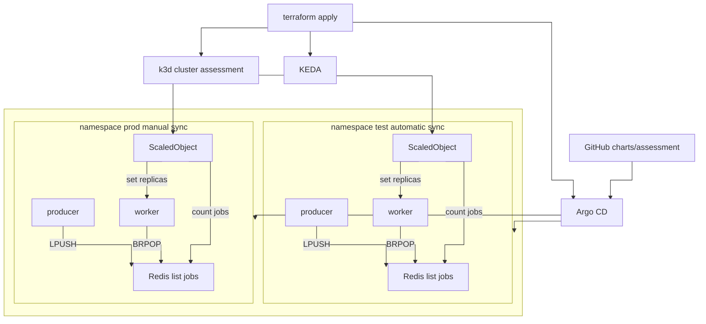

# Starter app

This app is a small job queue. It has two components that share one Redis list:

- The **producer** puts jobs on the list.
- The **worker** takes jobs from the list and processes them.

You deploy this app to Kubernetes. You do not need to change the code.

```
client --POST /jobs--> producer --LPUSH--> Redis list "jobs" --BRPOP--> worker
```

## Components

### Producer

- Listens for HTTP on port 8080.
- `POST /jobs?count=N` puts N jobs on the list. N is 1 by default. The maximum is 10000; a larger value is reduced to
  10000.
- The response is JSON, for example `{"enqueued": 50, "queue_depth": 50}`. `queue_depth` is the length of the list after
  the push.
- When `PRODUCE_RATE` is more than 0, the producer also puts jobs on the list continuously, at that number of jobs per
  second.

### Worker

- Takes one job at a time from the list (`BRPOP`). Jobs are processed in the order they were added.
- Each job takes `JOB_DURATION`. Almost all of the time is spent waiting on a simulated downstream call.
- Processes `WORKER_CONCURRENCY` jobs at the same time per process.
- Listens for HTTP on port 8080.

Both components connect to Redis lazily. They start when Redis is not available, and retry until it is.

## Configuration

All configuration is read from environment variables.

| Variable             | Used by  | Default          | Description                                                                                          |
|----------------------|----------|------------------|------------------------------------------------------------------------------------------------------|
| `REDIS_ADDR`         | both     | `localhost:6379` | Redis address, `host:port`.                                                                          |
| `REDIS_PASSWORD`     | both     | (empty)          | Redis password. Leave empty when Redis has no password.                                              |
| `QUEUE_NAME`         | both     | `jobs`           | Name of the Redis list. Producer and worker must use the same name.                                  |
| `PRODUCE_RATE`       | producer | `0`              | Jobs per second to produce in the background. A decimal number from 0 to 1000. `0` turns it off.     |
| `JOB_DURATION`       | worker   | `2s`             | Time to process one job, as a Go duration: `500ms`, `2s`, `1m`. A number without a unit is an error. |
| `WORKER_CONCURRENCY` | worker   | `1`              | Number of jobs one worker process handles at the same time.                                          |

The HTTP port is always 8080. An invalid value stops the process at startup with an error in the log.

## Endpoints

| Path                 | Producer | Worker | Description                                               |
|----------------------|----------|--------|-----------------------------------------------------------|
| `POST /jobs?count=N` | yes      | no     | Put N jobs on the list.                                   |
| `GET /healthz`       | yes      | yes    | Returns 200 when the process runs. Does not check Redis.  |
| `GET /readyz`        | yes      | yes    | Returns 200 when Redis responds to `PING`, otherwise 503. |
| `GET /metrics`       | yes      | yes    | Prometheus metrics.                                       |

## Metrics

| Metric                            | Type      | Component | Description                                                                       |
|-----------------------------------|-----------|-----------|-----------------------------------------------------------------------------------|
| `assessment_jobs_enqueued_total`  | counter   | producer  | Jobs pushed onto the list.                                                        |
| `assessment_queue_depth`          | gauge     | producer  | Jobs waiting in the list (`LLEN`). Refreshed every 5 seconds and after each push. |
| `assessment_jobs_processed_total` | counter   | worker    | Jobs processed.                                                                   |
| `assessment_job_duration_seconds` | histogram | worker    | Time to process one job.                                                          |
| `assessment_jobs_in_progress`     | gauge     | worker    | Jobs being processed right now.                                                   |

`/metrics` also shows the standard Go and process metrics.

## Logs

Both components write JSON to stdout, one object per line. They log the configuration at startup (never the password),
one line per enqueue call, and one line per job processed.

## Images

There are no published images. To build them, run these commands in this directory. They are built for the architecture
of your machine.

```sh
docker build -f Dockerfile.producer -t assessment-producer:1.0.0 --provenance=false --sbom=false .
docker build -f Dockerfile.worker -t assessment-worker:1.0.0 --provenance=false --sbom=false .
```

`--provenance=false` and `--sbom=false` keep the image loadable by `k3d image import`.

The images use `gcr.io/distroless/static-debian12:nonroot`. They run as the numeric user `65532` and contain no shell.

## Run locally with Docker Compose

Docker Compose starts Redis, one producer and one worker. It builds the images if they do not exist.

```sh
docker compose up --build -d
```

On your machine, the producer is on port 8080 and the worker is on port 8082.

Put 50 jobs on the list:

```sh
curl -X POST 'localhost:8080/jobs?count=50'
```

Watch the list become empty:

```sh
curl -s localhost:8080/metrics | grep assessment_queue_depth
curl -s localhost:8082/metrics | grep assessment_jobs
docker compose logs -f worker
docker compose exec redis redis-cli LLEN jobs
```

Stop and remove everything:

```sh
docker compose down -v
```

## Behaviour

- **Job duration.** One job takes `JOB_DURATION`. One worker process handles `WORKER_CONCURRENCY` jobs at the same time.
  So one process handles at most `WORKER_CONCURRENCY / JOB_DURATION` jobs per second. With the defaults, that is 0.5
  jobs per second.
- **Resources.** Each process uses less than 5m CPU and about 10 MiB of memory.
- **Order.** The producer adds jobs to the head of the list and the worker takes them from the tail. The oldest job is
  processed first.
- **Delivery.** A job is removed from the list when a worker takes it. There is no acknowledgement and no retry. If a
  worker process is killed while it processes a job, that job is lost.
- **Shutdown.** On `SIGTERM` or `SIGINT`, the worker stops taking new jobs, finishes the jobs it is processing, and then
  exits. It logs when shutdown starts and when the jobs in progress are finished. This takes up to `JOB_DURATION`, plus
  up to 1 second for an idle wait on the list to return. If the process is killed before that, the jobs in progress are
  lost. The producer stops at once on `SIGTERM`.

## Local cluster

Tools: Docker, Terraform, Helm, k3d, kubectl. Run the commands from the `terraform` folder, except the image import.

`terraform apply` creates the k3d cluster `assessment`, writes `.kube/config` in this repository, and installs Argo CD and KEDA.

Terraform creates the cluster and installs Argo CD and KEDA. Argo CD installs Redis, the producer, the worker, and the ScaledObject, because test and prod sync differently and the scale rule is per environment.



KEDA changes only the worker replica count. The producer and Redis stay at one replica. `prod` gets the same chart only after a manual sync, so it has its own Redis list.

### Quick start

On a clean machine, this script builds the images, creates the cluster, installs Argo CD and KEDA, loads the images, and registers the test and prod Applications. The commands below are the same steps one by one. The 500-job test is not part of this script.

```sh
bash scripts/quickstart.sh
```

### terraform version

`versions.tf` requires Terraform 1.5.0 or newer.

```sh
terraform version
```

The version must be 1.5.0 or newer. On this PC the result is:

> Terraform v1.17.2
> on windows_amd64

### terraform init

```sh
terraform init
```

Expected:

> Terraform has been successfully initialized!

### terraform apply

```sh
terraform apply
```

Expected:

> Plan: 3 to add, 0 to change, 0 to destroy.
> Apply complete! Resources: 3 added, 0 changed, 0 destroyed.

### kubectl get nodes

```sh
kubectl --kubeconfig ../.kube/config get nodes
```

Expected:

> NAME                      STATUS   ROLES           AGE   VERSION
> k3d-assessment-server-0   Ready    control-plane   12m   v1.35.5+k3s1

`STATUS` must be `Ready`. Age and version can differ.

### kubectl get pods -n argocd

```sh
kubectl --kubeconfig ../.kube/config get pods -n argocd
```

Expected:

> NAME                                                READY   STATUS    RESTARTS   AGE
> argocd-application-controller-0                     1/1     Running   0          3m56s
> argocd-applicationset-controller-6f9998557f-77llt   1/1     Running   0          3m56s
> argocd-dex-server-6987d99d7f-8ngss                  1/1     Running   0          3m56s
> argocd-notifications-controller-667c5d7b9f-ks7vr    1/1     Running   0          3m56s
> argocd-redis-597f5c54f4-nj4ns                       1/1     Running   0          3m56s
> argocd-repo-server-7bb54d7dd5-zzs99                 1/1     Running   0          3m56s
> argocd-server-5bcc8bd7db-4ghrr                      1/1     Running   0          3m56s

Every pod is `Running` and `1/1`. The suffix and the age can differ. `argocd-redis` belongs to Argo CD. The producer and the worker are not deployed.

### kubectl get pods -n keda

KEDA is the autoscaler. The worker sleeps, so CPU does not rise with the queue.

```sh
kubectl --kubeconfig ../.kube/config get pods -n keda
```

Expected:

> NAME                                               READY   STATUS    RESTARTS   AGE
> keda-admission-webhooks-7b9bcf8654-858rs           1/1     Running   0          80s
> keda-operator-58676658b-vhpt5                      1/1     Running   0          80s
> keda-operator-metrics-apiserver-6959bf9d7d-lcxj6   1/1     Running   0          80s

Every pod is `Running` and `1/1`. The suffix, the restart count, and the age can differ.

### k3d image import

Run this from the repository root after the images are built. The tag is `1.0.0`. The images are loaded into the `assessment` node because there is no registry.

```sh
k3d image import assessment-producer:1.0.0 --cluster assessment --mode direct
k3d image import assessment-worker:1.0.0 --cluster assessment --mode direct
```

Expected:

> Successfully imported 1 image(s) into 1 cluster(s)

### Argo CD applications

Run this from the repository root. `assessment-test` syncs by itself. `assessment-prod` does not.

```sh
kubectl --kubeconfig .kube/config apply -f argocd/application-test.yaml
kubectl --kubeconfig .kube/config apply -f argocd/application-prod.yaml
kubectl --kubeconfig .kube/config get applications -n argocd
```

Expected:

> NAME              SYNC STATUS   HEALTH STATUS
> assessment-prod   OutOfSync     Missing
> assessment-test   Synced        Progressing

`assessment-test` becomes `Healthy` when its pods are `Running`. The pod names and the age can differ.

```sh
kubectl --kubeconfig .kube/config get pods -n test
```

Expected:

> NAME                        READY   STATUS    RESTARTS   AGE
> producer-6db88f774c-rldcw   1/1     Running   0          17s
> redis-c46d5dffc-lvvfm       1/1     Running   0          17s
> worker-86b8487c-hmdwj       1/1     Running   0          17s

### 500 jobs in test

Run these from the repository root and leave the port-forward running. The signal is the Redis list `jobs`, not CPU: listLength 50, min 1, max 10, so 500/50 reaches 10 and an empty list returns to 1.

```sh
kubectl --kubeconfig .kube/config port-forward -n test svc/producer 8080:8080
```

```sh
curl -s -X POST "http://127.0.0.1:8080/jobs?count=500"
```

Expected:

> {"enqueued":500,"queue_depth":500}

```sh
kubectl --kubeconfig .kube/config get deploy worker -n test -w
```

Expected:

> worker 10/10
> worker 8/8
> worker 6/6
> worker 4/4
> worker 3/3
> worker 1/1

### Local cluster behaviour

- Signal. KEDA counts the Redis list jobs. The worker sleeps for JOB_DURATION, so CPU stays near zero and a CPU autoscaler would not change the replica count.
- Worker only. The ScaledObject targets the worker Deployment. The producer and Redis stay at one replica.
- Thresholds. listLength is 50, minimum is 1, maximum is 10, cooldown is 180 seconds. 500 waiting jobs reach 10 replicas. An empty list returns the count to 1.
- Where it runs. The scale rule is in the chart. test receives it on automatic sync. prod receives it only after a manual sync.

### Optional: prod

The kubeconfig stays `.kube/config`. Replace `-n test` with `-n prod`. `prod` does not sync until you start it.

```sh
kubectl --kubeconfig .kube/config patch application assessment-prod -n argocd --type merge -p '{"operation":{"sync":{"revision":"HEAD"}}}'
kubectl --kubeconfig .kube/config get applications -n argocd
kubectl --kubeconfig .kube/config get pods -n prod
```

Expected:

> assessment-prod   Synced
> producer, redis, and worker Running in prod

`prod` has its own Redis list. A later manual sync sets the worker replica count back to 1. `test` ignores that field.

To send jobs to prod without using port 8080:

```sh
kubectl --kubeconfig .kube/config port-forward -n prod svc/producer 8090:8080
```

```sh
curl -s -X POST "http://127.0.0.1:8090/jobs?count=50"
```

### sed, only if get nodes cannot connect

This replaces `host.docker.internal` with `127.0.0.1` in `.kube/config` inside this repository.

```sh
sed -i 's/host.docker.internal/127.0.0.1/' ../.kube/config
kubectl --kubeconfig ../.kube/config get nodes
```

Expected result: the same `Ready` node as above.

### terraform destroy

```sh
terraform destroy
```

Expected:

> Destroy complete! Resources: 3 destroyed.

### Optional

```sh
grep server ../.kube/config
```

Expected:

> server: https://127.0.0.1:59280

The port can differ.

```sh
kubectl config current-context
```

This reads `~/.kube/config` and must not print `k3d-assessment`. On this PC, where no context was set, the result is:

> error: current-context is not set

```sh
kubectl --kubeconfig ../.kube/config get pods -A
```

This lists `kube-system`, `argocd`, and `test`. `prod` stays empty until someone syncs it.
