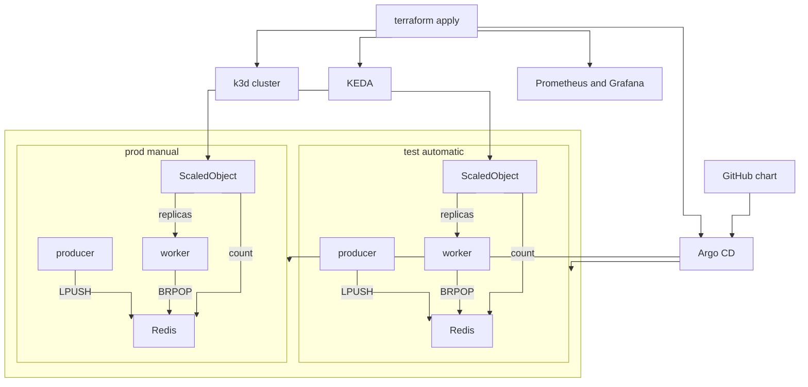

# Local cluster

Tools: Docker, Terraform, Helm, k3d, kubectl.

Terraform creates the cluster and installs Argo CD, KEDA, Prometheus, and Grafana. Argo CD installs Redis, the producer, the worker, and the scale rule from Git. `test` syncs by itself. `prod` starts only when you ask for it. Each namespace has its own Redis list. KEDA changes only the worker replica count, using the length of that list. The worker sleeps, so CPU stays near zero.



## Install

From the repository root.

RUN THIS:

```sh
bash scripts/quickstart.sh
```

RUN THIS TO VERIFY that test is up and prod is empty:

```sh
kubectl --kubeconfig .kube/config get pods -n test
kubectl --kubeconfig .kube/config get applications -n argocd
```

Expected:

> producer, redis, and worker Running in test
> assessment-test Synced
> assessment-prod OutOfSync

### Prod - Optional

RUN THIS only when you want prod pods. Prod has its own Redis list.

```sh
kubectl --kubeconfig .kube/config patch application assessment-prod -n argocd --type merge -p '{"operation":{"sync":{"revision":"HEAD","syncOptions":["CreateNamespace=true"]}}}'
```

RUN THIS TO VERIFY:

```sh
kubectl --kubeconfig .kube/config get pods -n prod
```

Expected:

> producer, redis, and worker Running in prod

### Remove - Optional

RUN THIS to delete the cluster. The local images stay.

```sh
bash scripts/teardown.sh
```

## 500 jobs in test

listLength is 50, minimum is 1, maximum is 10. 500 jobs reach 10 workers, then the count returns to 1.

RUN THIS and leave it running:

```sh
kubectl --kubeconfig .kube/config port-forward -n test svc/producer 8080:8080
```

RUN THIS in a second terminal.

```sh
curl -s -X POST "http://127.0.0.1:8080/jobs?count=500"
```

Expected:

> {"enqueued":500,"queue_depth":500}

RUN THIS TO VERIFY the worker count in the second terminal:

```sh
kubectl --kubeconfig .kube/config get deploy worker -n test -w
```

Expected:

> worker 10/10
> worker 8/8
> worker 6/6
> worker 4/4
> worker 3/3
> worker 1/1

## Dashboards

This is the same test on the screen. The terminal result above is the record.

The Assessment dashboard files are on this PC and not on GitHub yet.

The top row is the problem row: node Ready, memory pressure, disk pressure, PID pressure, pods that are not Running, and WorkerAtMaxReplicas. Green means ok. The next row is the current replica count for the worker, producer, and Redis in test and prod. A bar shows how many pods are Running in each namespace. Worker replicas, queue depth, and jobs per second stay as time series, because those change over the few minutes of the test. The worker axis is 0 to 10. The table is how long each pod has been up. Node CPU and node memory are the overload numbers, in percent. CPU and memory by namespace come from the kubelet. The worker uses almost no CPU, because the job is a 2 second sleep.

WorkerAtMaxReplicas fires when more than 50 jobs wait for 2 minutes and the worker is already at 10 replicas. KEDA cannot add another worker.

RUN THIS from the repository root:

```sh
bash scripts/dashboards.sh
```

The script prints these three links and opens them. Grafana is port 3000, Argo CD is port 8443, Prometheus is port 9090. Port 8080 stays the producer test.

- Grafana: http://grafana.localtest.me:3000/d/assessment/scale — user admin, password admin
- Argo CD: https://argocd.localtest.me:8443 — accept the certificate warning; user admin, password admin; click assessment-test for the resource tree
- Prometheus: http://prometheus.localtest.me:9090/alerts — no login

The terminal 500-job commands stay separate; this script only opens the screens.

The three links are printed by scripts/dashboards.sh; grafana.localtest.me, argocd.localtest.me, and prometheus.localtest.me are public DNS names, localtest.me already points at 127.0.0.1 so those three names do too, and nothing for this DNS was added in the repo, the hosts file, or the cluster. Those names are only for the three browser pages (Grafana, Argo CD, Prometheus); the 500-job curl stays on http://127.0.0.1:8080, and producer, worker, and Redis keep their cluster addresses.

### Home kubeconfig

RUN THIS TO VERIFY that the home kubeconfig was not switched:

```sh
kubectl config current-context
```

Expected:

> This reads ~/.kube/config and must not print k3d-assessment.
